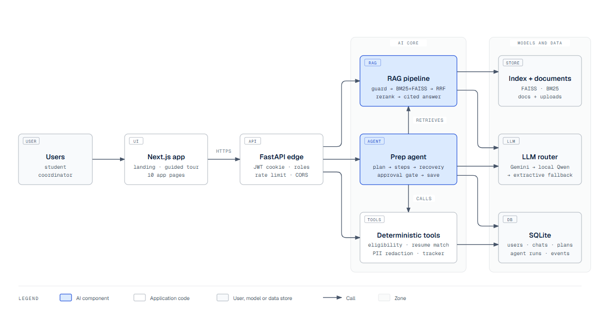
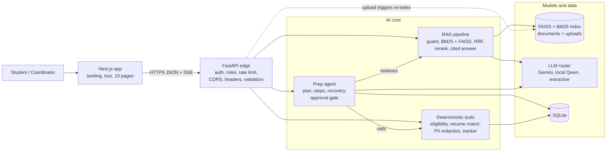

# Architecture

## 1. Overview

*Source: [architecture-diagram.html](architecture-diagram.html) (also exported as [SVG](architecture-diagram.svg)). To stay readable the figure merges the two user roles into one node and the landing page and app pages into one frontend node, and it leaves out the coordinator's upload path, which is described in section 6.*

Mermaid version of the same structure:

## 2. Components

| Component | Where | Responsibility |
|---|---|---|
| Frontend | `frontend/` | Landing page, Guided Tour, ten app pages. Holds no business logic. |
| API edge | `backend/app/main.py`, `app/api/`, `app/security/` | Authentication, role checks, validation, rate limiting, CORS, security headers, error envelope |
| RAG pipeline | `backend/app/rag/` | Ingestion, chunking, index, hybrid retrieval, rerank, prompt, citations, refusal |
| LLM router | `backend/app/llm/` | Tries Gemini, then the local model, then extractive; reports which one answered |
| Tools | `backend/app/tools/` | Eligibility, resume match, application tracking, company catalogue |
| Prep agent | `backend/app/agent/` | Planner, step executor, recovery, approval gate |
| Guards | `backend/app/security/injection.py`, `pii.py` | Injection scan on input and documents, output filter, PII redaction |
| Storage | `backend/storage/` (not committed) | SQLite database, index files, uploads, logs |
| Evaluation | `eval/` | Case set, runner, metrics, charts |

## 3. Why each AI component is here

The brief asks for components that fit the problem, not every technique. Each one below exists because a specific requirement could not be met without it.

### RAG, the core
Placement information lives in documents that change every season: a new company notice, a revised policy. A model cannot know them, and retraining for each notice is absurd. Retrieval lets the answer come from the current document and lets the student check it through the citation. Three choices inside the pipeline:

- **Hybrid retrieval (BM25 + vectors, fused with RRF).** Student questions mix exact tokens ("Nimbusware", "7.5 CGPA", "one-offer") with paraphrase ("can I sit for another company after getting placed?"). BM25 catches the first kind, embeddings the second. RRF combines the two rankings without having to normalise their scores.
- **Cross-encoder reranking.** The first stage is tuned for recall. The reranker reads the question and each candidate together and puts the passage that actually answers it at the top. Its score also drives the refusal decision.
- **Refusal below a threshold.** If the best passage scores too low, the system says the documents do not cover it. For a student deciding whether to apply, a wrong answer is worse than no answer.

### Tools, for what must not be guessed
- **`check_eligibility`** compares numbers and sets: CGPA against a cut-off, backlog count against a limit, branch against a list, batch against a year. A language model asked to do this can get "7.0 is at least 7.0" wrong and cannot be audited. A function cannot get it wrong and returns the reason for each criterion.
- **`match_resume`** uses a skill vocabulary plus embedding similarity. The embedding model is the AI part; the score formula is fixed and shown to the user.
- **`track_application`** is a database write. There is nothing for a model to decide.

### Agent, for one goal only
"Prepare me for Nimbusware" needs several dependent steps: eligibility, then resume gaps, then that company's process and seniors' experiences, then a plan that uses all of it, then a save. The steps depend on each other's results (an ineligible student should not get a plan to apply), some can fail, and the last one changes data. That is what an agent loop with state, recovery and an approval gate is for. Every other feature is a single fixed pipeline, so it is not an agent.

The planner is rule-based and the executor is a plain loop. A model writes the plan text; it does not choose which tools run. For a five-step goal with a known shape, letting a small local model pick tools would add failure modes and no capability.

### What is not used, and why
| Technique | Why not |
|---|---|
| Fine-tuning | The knowledge changes every season and must be citable. Retrieval gives both; a fine-tuned model gives neither. |
| Image, audio or video models | Every input and output is text. |
| Multi-agent systems | One goal, five steps, one user. A second agent would only add coordination overhead. |
| LLM-chosen tool calls | The step order is known. A deterministic plan is testable and works even on the extractive fallback. |
| An agent framework | The loop is about 150 lines. Writing it keeps state, retries and the approval gate explicit and easy to explain. |
| A vector database server | A few hundred chunks fit in an in-process FAISS index that rebuilds in seconds. |

## 4. Data flow: Ask (RAG)

1. `POST /api/ask/stream` with the question. The edge checks the session cookie, the rate limit and the input length.
2. **Guard.** `scan_user_input` looks for instruction-override patterns. A hit ends the request with a "blocked" result and a security event; nothing is retrieved.
3. **Retrieve.** BM25 top 20 and FAISS top 20 are fused with RRF (k = 60).
4. **Rerank.** The cross-encoder scores the fused candidates; the top 5 are kept.
5. **Refusal check.** If the top score is under the threshold, the fixed refusal message is returned and no model is called.
6. **Generate.** The prompt contains the numbered passages inside delimiters, with the instruction that they are data, not instructions. The router tries Gemini, then the local model, then extractive.
7. **Output filter.** Citations that point outside the passage list are removed; system-prompt leaks and PII patterns are stripped.
8. The answer, citations, source cards, pipeline steps, provider and latency are returned and stored in the conversation. An event is logged for analytics.

## 5. Data flow: tools

- **Eligibility.** `POST /api/tools/eligibility` -> the student's profile is loaded from the database, the company from the catalogue -> `check_eligibility` returns one result per criterion -> event logged.
- **Resume match.** `POST /api/tools/resume-match` -> `redact_pii` -> skill extraction on resume and job description -> embedding similarity on the redacted text -> score, matched and missing skills, and the redaction counts.
- **Applications.** CRUD on the `applications` table, scoped to the logged-in student.

## 6. Data flow: prep agent

1. `POST /api/agent/runs` with a company id. The planner builds the step list from the student's state (for example, no resume means the resume step is planned as skipped).
2. The executor runs each step, saving the run state after every one:
   `check_eligibility` -> `match_resume` -> `retrieve_process` -> `retrieve_experiences` -> `build_plan`.
3. **Recovery.** A failing step is retried up to twice. If it still fails: a required step uses its fallback (the plan builder falls back to a template plan; process retrieval falls back to the company file), an optional step is skipped and marked as such.
4. If the student is not eligible, the run ends with the failed criteria and eligible alternatives. Nothing is offered for saving.
5. Otherwise the run stops in `awaiting_approval`. The response carries the exact plan and application that would be saved.
6. `POST /api/agent/runs/{id}/approve` writes the prep plan and the application in one transaction. `reject` marks the run rejected and writes nothing. A second approve is refused.

**Coordinator upload.** `POST /api/admin/documents` validates the file (type, size, content, filename), sanitises instruction-like lines, stores it, and rebuilds the index. The new content is searchable on the next question.

## 7. Data model

| Table | Purpose |
|---|---|
| `users` | Email, password hash, role |
| `student_profiles` | Branch, CGPA, active backlogs, batch, resume text |
| `documents` | Indexed documents: seeded and uploaded, with type and checksum |
| `conversations`, `messages` | Saved questions and answers with citations and provider |
| `applications` | Company, status, deadline, notes |
| `prep_plans` | Approved week-by-week plans |
| `agent_runs` | Run status, plan, per-step state, pending approval payload |
| `events` | Analytics and audit log (question asked, refusal, blocked input, eligibility check, upload) |

## 8. Security architecture

Checks happen at three layers. The edge handles identity and abuse (cookie session, roles, rate limit, CORS, headers, origin check). The guards handle model-specific risks (prompt injection in input and in documents, output filtering, PII redaction). The tools enforce ownership (a student only reaches their own profile, runs and applications). `SECURITY.md` lists each measure with its file and test.

## 9. Runtime and deployment

Two local processes: `uvicorn` on port 8000 and `next` on port 3000, started together by `scripts/dev.ps1`. Models are loaded once at startup from the Hugging Face cache. Everything written at runtime goes under `backend/storage/`.
